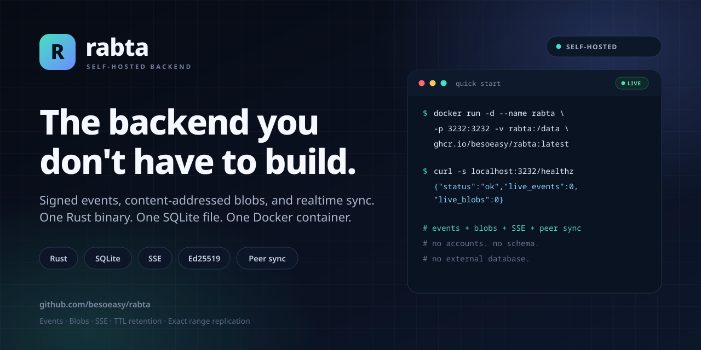
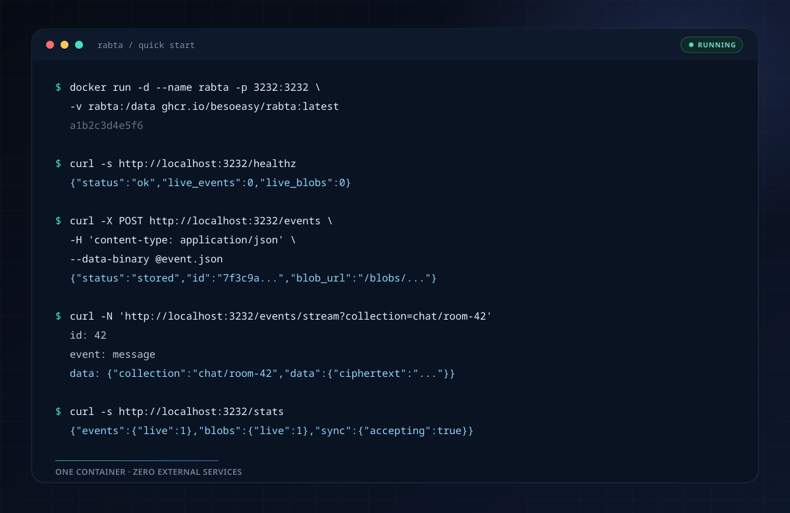
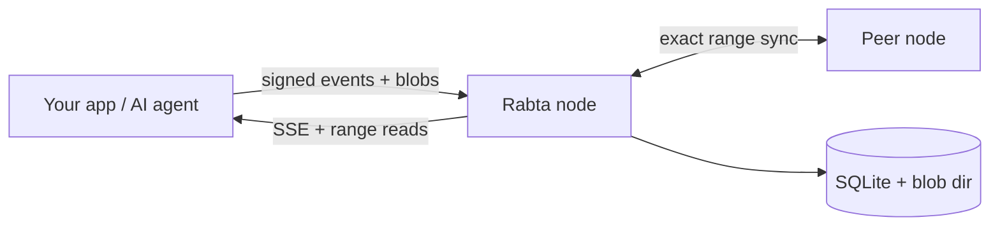

# Rabta

### The self-hosted, zero-knowledge backend for events, blobs, and realtime sync.

[](https://github.com/besoeasy/rabta/stargazers)
[](https://www.rust-lang.org/)
[](https://sqlite.org/)
[](https://github.com/besoeasy/rabta/pkgs/container/rabta)
[](src/sync/ranges.rs)

<p align="center">
  
</p>

Rabta is the backend you run when you want to **ship the product, not the infrastructure**. It stores signed events and content-addressed blobs, streams changes over SSE, expires data automatically, and replicates to peers — all from one Rust binary, one SQLite file, and one Docker container.

**No accounts. No app schema. No database server. No vendor lock-in.**

Clients encrypt and sign. Rabta verifies signatures, stores opaque envelopes, and never needs to understand your data.

> **API reference:** [**api.md**](api.md) — every route, the cryptography, wire formats, blob lifecycle, and sync protocol v1.
>
> **Jump to:** [publish an event](api.md#post-events) · [stream over SSE](api.md#get-eventsstream) · [attach a blob](api.md#put-blobsnameblobbin) · [replicate](api.md#sync-protocol-v1)

## Why Rabta?

- **Zero-knowledge by design** — payloads are encrypted and signed by clients; the node only sees ciphertext and metadata.
- **One container, zero ops** — Rust + SQLite + a blob directory. No Postgres, Redis, Kafka, or cloud account required.
- **Events and blobs together** — JSON event envelopes plus content-addressed files with `Range` and `ETag` support.
- **Realtime without extra services** — built-in Server-Sent Events with `Last-Event-ID` resume.
- **Retention that runs itself** — every event has a TTL; expired rows and orphaned blobs are reclaimed automatically.
- **Exact peer replication** — Merkle range reconciliation syncs events bidirectionally and pulls missing blob bodies.
- **Safe by default** — Ed25519 verification, size limits, storage watermark, and eviction before the disk fills.
- **Browser-ready** — permissive CORS, plain HTTP, and no proprietary client SDK required.

## What you can build

| You're building | Rabta gives you |
| --- | --- |
| **AI agents** | Shared memory, task queues, and append-only event logs between agents |
| **Local-first / offline-first apps** | Sync-friendly event streams with encrypted payloads and file attachments |
| **Chat and collaboration** | Rooms, presence, messages, and live updates over SSE |
| **Nostr clients and relays** | Signed event storage and relay-style access over plain HTTP |
| **Multiplayer games** | Ephemeral rooms, player state, and assets that clean themselves up |
| **IoT and telemetry** | Signed time-series events with automatic retention |
| **Webhooks and integrations** | A durable event inbox/outbox without running a message broker |
| **File drop and media** | SHA-256 content-addressed storage with range reads |

## Quick start

```bash
docker run -d \
  --name rabta \
  -p 3232:3232 \
  -v rabta:/data \
  --restart unless-stopped \
  ghcr.io/besoeasy/rabta:latest

curl -s http://localhost:3232/healthz
# {"status":"ok","live_events":0,"live_blobs":0}
```

<p align="center">
  
</p>

That's it. Your backend is live at `http://localhost:3232`.

Images are published for **linux/amd64** and **linux/arm64**. Tags: `latest`, `X.X.X`, and `dev`.

Rabta serves no HTML. A UI is a static app hosted anywhere that points at the node URL.

## How it works



1. **The client owns the data model.** It canonicalizes JSON, hashes it, signs with Ed25519, and optionally encrypts the payload.
2. **Rabta verifies and stores.** The node checks the signature and TTL, then writes an opaque envelope to SQLite.
3. **The event goes live.** Subscribers receive it over SSE; attached blobs are fetched by hash.
4. **Peers reconcile.** Nodes exchange exact range summaries and transfer only the keys and bodies they are missing.

The server never parses your application data, never runs your schema, and never needs a plaintext copy.

## Developer docs

Everything developers need lives in [**api.md**](api.md):

- [Event envelope, canonical JSON, and Ed25519 signing](api.md#cryptography-and-the-event-envelope)
- [All public routes and exact response shapes](api.md#public-routes)
- [Blob upload, range reads, and the orphan lifecycle](api.md#blob-lifecycle)
- [Sync protocol v1 wire format and reconciliation algorithm](api.md#sync-protocol-v1)
- [Limits, environment variables, and copy-paste examples](api.md#limits-and-runtime-configuration)

The short version:

```bash
# Publish a signed envelope.
curl -X POST http://localhost:3232/events \
  -H 'content-type: application/json' \
  --data-binary @event.json

# Upload bytes, then reference the returned hash from an event.
curl -X PUT --data-binary @file.bin http://localhost:3232/blobs/file.bin

# Stream live events.
curl -N 'http://localhost:3232/events/stream?collection=chat/room-42'
```

The root route returns a machine-readable index of the public endpoints, plus the sync routes when peers are configured.

## Replicate

```bash
docker run -d \
  --name rabta \
  -p 3232:3232 \
  -v rabta:/data \
  -e NODES=http://node-b:3232,http://node-c:3232 \
  ghcr.io/besoeasy/rabta:latest
```

New events push to peers immediately. Every 60 seconds each node reconciles exact sorted-key ranges: matching ranges are skipped by count plus fingerprint, small ranges exchange IDs directly, and larger mismatches split by nibble. Event bodies move in both directions; blob bodies are pull-only and are also healed on read.

Replication is designed for small, self-managed clusters of up to **8 peers**. It is not a consensus system: nodes converge toward the union of live data, subject to TTL and eviction. See [Sync protocol v1](api.md#sync-protocol-v1) for the wire format.

## Configuration and limits

Set environment variables, or put `KEY=VALUE` lines in `/data/config.env`. Process environment wins. The common knobs are `PORT`, `DATA_DIR`, `STORAGE_MAX`, `SSE_SUBSCRIBER_CAP`, and `NODES`.

Defaults: 100 KB event envelopes, event TTLs above 60 seconds and up to 365 days, blobs capped at 10% of `STORAGE_MAX`, and orphaned blobs removed after one hour.

The full table is in [Limits and runtime configuration](api.md#limits-and-runtime-configuration).

## Privacy model

Rabta is zero-knowledge in the practical sense: it has no accounts, no application logic, and never needs plaintext. It does see metadata — public key, collection, labels, sizes, and timing. Encrypt payloads client-side when that metadata matters.

For a hardened deployment, put the node behind TLS and an authenticated reverse proxy if it is reachable from the internet, and keep sync ports on a private network.

## Project status

Rabta is under active development (`0.0.1-dev`). The core API is deliberately small, and the sync protocol is versioned at v1. Issues and pull requests are welcome.

If Rabta saves you from building a backend, a ⭐ helps other builders discover it.

## Keywords

Self-hosted backend · Rust backend · SQLite backend · event store · blob storage · content-addressed storage · object storage · realtime API · Server-Sent Events · SSE · local-first sync · offline-first apps · peer-to-peer replication · distributed systems · Ed25519 · end-to-end encryption · zero-knowledge backend · privacy-first · AI agent memory · Nostr relay · Docker · Axum · backend as a service
